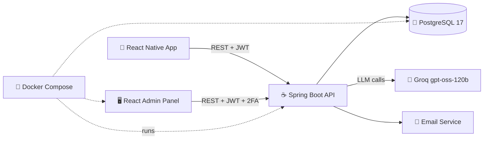
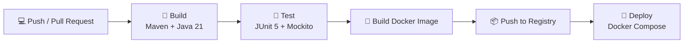

<!-- ═══════════════ HEADER ═══════════════ -->
<p align="center">
  
</p>

<p align="center">
  <a href="https://git.io/typing-svg">
    
  </a>
</p>

<p align="center">
  
  
  
</p>

<p align="center">
  <a href="mailto:hariskhatti.dev@gmail.com"></a>
  <a href="https://www.linkedin.com/in/haris-khatti-a97526208/"></a>
  <a href="https://hariskhatti.netlify.app/"></a>
</p>

---

## 🧭 About Me

I'm a **Java Backend Developer** who builds **secure, scalable, production-style backend systems** with **Java 21, Spring Boot and PostgreSQL**.

I don't stop at CRUD. I care about the parts that make a backend real:

- 🔐 **Authentication & authorization** — JWT, role-based access, email-based 2FA, token rotation
- 🏗️ **Clean layered architecture** — controllers → services → repositories, centralized exception handling
- 🗄️ **Database design & migrations** — PostgreSQL, Flyway versioned migrations, constraints & uniqueness rules
- 🤖 **AI integration** — LLM-powered features using **Groq** (`gpt-oss-120b`) behind secure backend APIs
- 🐳 **Containerization** — Docker & Docker Compose for backend + admin panel + database
- ⚙️ **CI/CD** — automated build, test and Docker image pipelines with **GitHub Actions**
- 🧪 **Testing** — JUnit 5 + Mockito

> 💡 I like understanding *why* something is built a certain way, not just *how*.

---

## 💼 Experience

<table>
<tr>
<td width="50%" valign="top">

### 🏥 Junior Java Backend Developer
**Softsincs** · `05 Jul 2026 – 02 Nov 2026`

Built the backend of **MediMentor** — an AI-powered clinical decision support platform for doctors in Pakistan — plus its **React admin panel** and a **React Native mobile app** (built with AI-assisted tooling).

</td>
<td width="50%" valign="top">

### 🚛 Backend Intern
**Novasinc** · `01 May 2026 – 02 Jun 2026`

Worked on **TruckFlow Pro**, a logistics & fleet management platform for Saudi Arabia, and introduced **Flyway database migrations** for versioned, repeatable schema changes.

</td>
</tr>
</table>

---

## 🚀 Featured Projects

### 🏥 MediMentor — AI-Powered Clinical Decision Support *(Softsincs)*


A three-part system: **Spring Boot backend API**, **React admin dashboard**, and a **React Native mobile app**.

**Backend highlights**
- 🔐 JWT auth with **admin email 2FA** (6-digit code, 60-second resend cooldown) and forced password change for temporary-password admins
- 🩺 **Doctor verification flow** — PM&DC number checks, duplicate-claim detection, approve / reject (with reason codes) / revoke
- 💬 **Patient & AI chat flow** powered by Groq LLM
- 📄 **Private patient document handling** with secure access
- 🩸 **Blood donor** and ⚡ **Quick Check** modules
- 📞 Phone-number uniqueness rules + centralized, consistent **exception handling** and response format
- 📧 Email features (2FA codes, notifications)
- 🧾 **Audit trail** of admin actions, exportable as CSV
- 🧪 Unit tests with **JUnit 5 + Mockito**

**Admin panel** — React 18 · Vite · React Router · Axios · lucide-react: dashboard stats, verification queue, doctor directory, user suspend/reactivate, admin management, audit logs.

**Mobile app** — Expo SDK 57 · React Native 0.86 · React 19 · TypeScript · React Navigation 7 · Zustand 5 *(built with AI tools)*.



> 🔒 *MediMentor is a private company project (Softsincs), so the source code isn't public.*

---

### 🚛 TruckFlow Pro — Logistics & Fleet Management *(Novasinc)*


A logistics and fleet management platform for the **Saudi Arabian** market. I added **Flyway-based database migrations** so schema changes are versioned, repeatable and safe across environments.

---

### 🧩 More on my profile

- 🔐 **Role-Based Authentication & Authorization** — JWT-secured REST APIs
- 🔄 **Token Rotation & Refresh Token Handling** — production-style session management
- ☁️ **Cloudinary Media Management** — image/file upload and cloud storage
- 🤖 **AI Integration** — LLM-enhanced backend services
- 🐳 **Dockerized Spring Boot apps** with PostgreSQL / MongoDB

👉 *Explore my repositories for more implementations.*

---

## 🛠️ Tech Stack

### ☕ Backend


### 🗄️ Databases & Migrations


### 🤖 AI / LLM


### ⚙️ DevOps & CI/CD


### 🧪 Testing & Tools


### 🎨 Frontend & Mobile


---

## ⚙️ CI/CD Pipeline I Use



<details>
<summary>📄 Example GitHub Actions workflow (Spring Boot)</summary>

```yaml
name: CI

on:
  push:
    branches: [main]
  pull_request:

jobs:
  build-and-test:
    runs-on: ubuntu-latest
    services:
      postgres:
        image: postgres:17
        env:
          POSTGRES_DB: testdb
          POSTGRES_USER: test
          POSTGRES_PASSWORD: test
        ports: ["5432:5432"]
    steps:
      - uses: actions/checkout@v4
      - uses: actions/setup-java@v4
        with:
          distribution: temurin
          java-version: 21
          cache: maven
      - name: Build & test
        run: mvn -B verify
      - name: Build Docker image
        run: docker build -t app:${{ github.sha }} .
```

</details>

---

## 📊 GitHub Stats

<p align="center">
  
  
</p>

<p align="center">
  
</p>

<p align="center">
  
</p>

---

## 🎯 Currently

- 🔭 Deepening **CI/CD** with GitHub Actions (build → test → Docker → deploy)
- 🤖 Building more **LLM-powered backend features** (Groq, prompt design, safe AI responses)
- ☁️ Cloud media management & secure token handling
- 📐 Studying **system design** — scalability, caching, and API security

---

<p align="center">
  ⭐ <b>Open to Java Backend Developer roles</b> where I can learn, contribute and grow.<br/>
  📫 Let's connect — <a href="mailto:hariskhatti.dev@gmail.com">hariskhatti.dev@gmail.com</a>
</p>

<p align="center">
  
</p>
