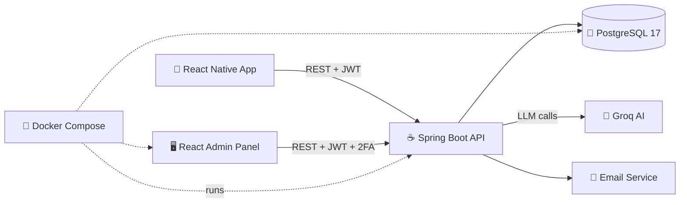
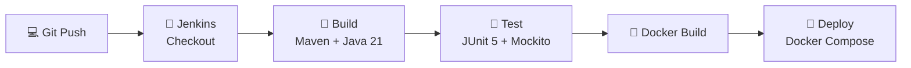

<!-- ═══════════════════════════ HERO ═══════════════════════════ -->
<p align="center">
  
</p>

<p align="center">
  <a href="https://git.io/typing-svg">
    
  </a>
</p>

<p align="center">
  
  
  
</p>

<p align="center">
  <a href="mailto:hariskhatti.dev@gmail.com"></a>
  <a href="https://www.linkedin.com/in/Hariskhatti-a97526208/"></a>
  <a href="https://hariskhatti.netlify.app/"></a>
</p>

<!-- ═══════════════════════════ NAVIGATION ═══════════════════════════ -->
<p align="center">
  <a href="#stack"><b>🛠️ Tech Stack</b></a> &nbsp;•&nbsp;
  <a href="#about"><b>🧭 About</b></a> &nbsp;•&nbsp;
  <a href="#experience"><b>💼 Experience</b></a> &nbsp;•&nbsp;
  <a href="#projects"><b>🚀 Projects</b></a> &nbsp;•&nbsp;
  <a href="#cicd"><b>⚙️ CI/CD</b></a> &nbsp;•&nbsp;
  <a href="#stats"><b>📊 Stats</b></a>
</p>

<!-- ═══════════════════════════ AT A GLANCE ═══════════════════════════ -->
<div align="center">

| 👨‍💻 **Role** | 📍 **Based in** | 🎯 **Focus** | 🏢 **Experience** |
|:-:|:-:|:-:|:-:|
| Java Backend Developer | Karachi, Pakistan | Secure REST APIs, AI features, CI/CD | Softsincs · Novasinc |

</div>

---

<!-- ═══════════════════════════ TECH STACK ═══════════════════════════ -->
<a name="stack"></a>
<h2 align="center">🛠️ Tech Stack</h2>
<p align="center"><sub>The tools I use to design, build, test and ship backend systems</sub></p>

<p align="center">
  <a href="https://skillicons.dev">
    
  </a>
</p>

<div align="center">

| | Category | Technologies |
|:-:|:--|:--|
| ☕ | **Backend** |         |
| 🗄️ | **Databases** |    |
| 🤖 | **AI / LLM** |   |
| ⚙️ | **DevOps & CI/CD** |     |
| 🧪 | **Testing & API Tools** |    
| 🎨 | **Frontend & Mobile** |           |

</div>

---

<!-- ═══════════════════════════ ABOUT ═══════════════════════════ -->
<a name="about"></a>
<h2 align="center">🧭 About Me</h2>

I'm a **Java Backend Developer** who builds **secure, scalable, production-style backend systems** with **Java 21, Spring Boot and PostgreSQL**. I don't stop at CRUD. I care about everything that makes a backend *real*.

### 🪜 How I build a backend — step by step

<table>
<tr>
<td align="center" width="16%"><h3>1️⃣</h3><b>Design</b><br/><sub>Layered architecture, DTOs, clean API contracts</sub></td>
<td align="center" width="16%"><h3>2️⃣</h3><b>Data</b><br/><sub>PostgreSQL schema, constraints, uniqueness rules</sub></td>
<td align="center" width="16%"><h3>3️⃣</h3><b>Secure</b><br/><sub>JWT, roles, email 2FA, token rotation</sub></td>
<td align="center" width="16%"><h3>4️⃣</h3><b>Test & Document</b><br/><sub>JUnit 5, Mockito, Swagger UI</sub></td>
<td align="center" width="16%"><h3>5️⃣</h3><b>Containerize</b><br/><sub>Docker & Docker Compose</sub></td>
<td align="center" width="16%"><h3>6️⃣</h3><b>Automate</b><br/><sub>Jenkins build → test → deploy</sub></td>
</tr>
</table>

> 💡 *I like understanding **why** something is built a certain way, not just **how**.*

---

<!-- ═══════════════════════════ EXPERIENCE ═══════════════════════════ -->
<a name="experience"></a>
<h2 align="center">💼 Experience</h2>

<table>
<tr>
<td width="50%" valign="top">

### 🏥 Junior Java Backend Developer
**Softsincs** &nbsp;·&nbsp; `05 Jul 2026 – 02 Nov 2026`

Built the backend of **MediMentor**, an AI-powered clinical decision support platform for doctors in Pakistan, plus its **React admin panel** and a **React Native mobile app** (built with AI-assisted tooling).

   

</td>
<td width="50%" valign="top">

### 🚛 Backend Intern
**Novasinc** &nbsp;·&nbsp; `01 May 2026 – 02 Jun 2026`

Worked on **TruckFlow Pro**, a logistics & fleet management platform for Saudi Arabia, and added **database migrations** for versioned, repeatable schema changes.

 

</td>
</tr>
</table>

---

<!-- ═══════════════════════════ PROJECTS ═══════════════════════════ -->
<a name="projects"></a>
<h2 align="center">🚀 Projects</h2>

<h3>🏥 MediMentor — AI-Powered Clinical Decision Support</h3>
<sub>**Softsincs** · Junior Java Backend Developer · `Jul – Nov 2026` · 🔒 Private company project</sub>

> AI-powered clinical decision support for doctors in Pakistan: a Spring Boot backend, a React admin dashboard and a React Native mobile app.


#### 🧩 System architecture



#### 🩺 Doctor verification — how it works

<table>
<tr>
<td align="center" width="20%"><h3>1️⃣</h3><b>Submit</b><br/><sub>Doctor submits PM&DC number & documents</sub></td>
<td align="center" width="20%"><h3>2️⃣</h3><b>Queue</b><br/><sub>Request appears in the admin verification queue</sub></td>
<td align="center" width="20%"><h3>3️⃣</h3><b>Review</b><br/><sub>Admin checks private documents & duplicate claims</sub></td>
<td align="center" width="20%"><h3>4️⃣</h3><b>Decide</b><br/><sub>Approve, reject (with reason code) or revoke</sub></td>
<td align="center" width="20%"><h3>5️⃣</h3><b>Audit</b><br/><sub>Every admin action is logged & exportable</sub></td>
</tr>
</table>

#### ✨ What I built

<table>
<tr>
<td width="50%" valign="top">

**⚙️ Backend (Spring Boot)**
- 🔐 JWT auth with **admin email 2FA** (6-digit code, 60 s resend cooldown) and forced password change for temp-password admins
- 🩺 **Doctor verification** with duplicate-claim detection
- 💬 **Patient & AI chat** powered by Groq AI
- 📄 **Private patient documents** with secure access
- 🩸 **Blood donor** and ⚡ **Quick Check** modules
- 📞 Phone-number uniqueness & centralized **exception handling**
- 🧾 **Audit trail** with CSV export
- 🧪 JUnit 5 + Mockito tests, 📘 Swagger UI docs

</td>
<td width="50%" valign="top">

**🖥️ Admin Panel (React 18 + Vite)**
- Sign-in with password + emailed 6-digit code
- Dashboard stats & oldest pending submissions
- Doctor verification queue & detail viewer
- Doctor directory with exact PM&DC lookup
- User management: suspend / reactivate
- Administrator management with temp passwords
- Audit trail with filters

**📱 Mobile App (React Native)**
- Expo SDK 57 · React Native 0.86 · React 19
- TypeScript · React Navigation 7 · Zustand 5
- *Built with AI-assisted tools*

</td>
</tr>
</table>

<br/>

<h3>🚛 TruckFlow Pro — Logistics & Fleet Management</h3>
<sub>**Novasinc** · Backend Intern · `May – Jun 2026`</sub>

> Logistics and fleet management platform for the **Saudi Arabian** market.


- 🗄️ Added **database migrations** so schema changes are versioned, repeatable and safe across environments

<br/>

<h3>🧩 Personal Projects</h3>
<sub>Available in my repositories section</sub>

| Project | What it covers |
|:--|:--|
| 🔐 **Role-Based Auth & Authorization** | JWT-secured REST APIs with role-based access control |
| 🔄 **Token Rotation & Refresh Tokens** | Production-style session management |
| ☁️ **Cloudinary Media Management** | Image/file upload and cloud storage in backend apps |
| 🤖 **AI Integration** | Backend services enhanced with LLM features |
| 🐳 **Dockerized Apps** | Spring Boot with PostgreSQL / MongoDB, ready to deploy |

---

<!-- ═══════════════════════════ CI/CD ═══════════════════════════ -->
<a name="cicd"></a>
<h2 align="center">⚙️ CI/CD with Jenkins</h2>
<p align="center"><sub>Every push goes through the same automated path, from code to a running container</sub></p>



<details>
<summary><b>📄 Example Jenkinsfile (Spring Boot)</b> — click to expand</summary>

```groovy
pipeline {
    agent any

    tools {
        maven 'Maven-3'   // configured in Jenkins > Tools
        jdk   'JDK-21'
    }

    stages {
        stage('Checkout') {
            steps { checkout scm }
        }
        stage('Build') {
            steps { sh 'mvn -B clean package -DskipTests' }
        }
        stage('Test') {
            steps { sh 'mvn -B test' }
            post { always { junit 'target/surefire-reports/*.xml' } }
        }
        stage('Docker Build') {
            steps { sh 'docker build -t my-app:${BUILD_NUMBER} .' }
        }
        stage('Deploy') {
            steps { sh 'docker compose up -d --build' }
        }
    }

    post {
        success { echo 'Pipeline completed successfully ✅' }
        failure { echo 'Pipeline failed ❌' }
    }
}
```

</details>

---

<!-- ═══════════════════════════ STATS ═══════════════════════════ -->
<a name="stats"></a>
<h2 align="center">📊 GitHub Stats</h2>

<p align="center">
  
  
</p>

<p align="center">
  
</p>

<p align="center">
  
</p>

---

## 🎯 Currently

- 🔭 Deepening **CI/CD** with Jenkins (build → test → Docker → deploy)
- 🤖 Building more **LLM-powered backend features** with Groq
- ☁️ Cloud media management & secure token handling
- 📐 Studying **system design**: scalability, caching and API security

---
<p align="center"> 🤝 <b>Open to opportunities and collaboration</b><br/> ⭐ Looking for Java Backend Developer roles where I can learn, contribute and grow.<br/> 📫 Let's connect: <a href="mailto:hariskhatti.dev@gmail.com">hariskhatti.dev@gmail.com</a> </p> <p align="center">  </p>
